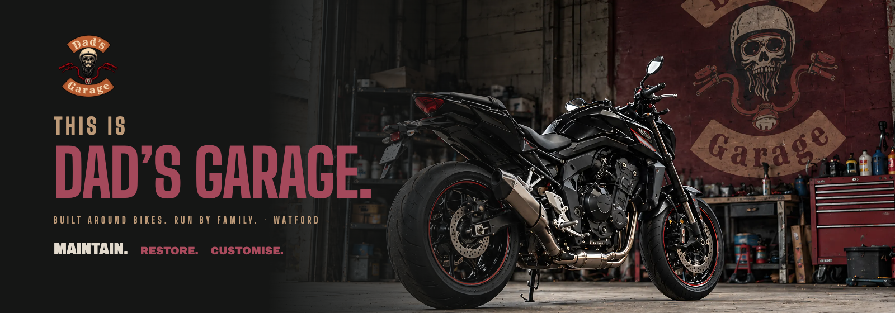
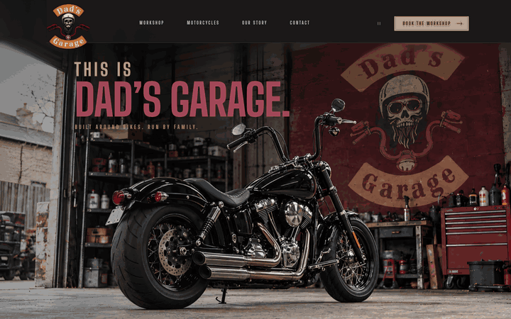
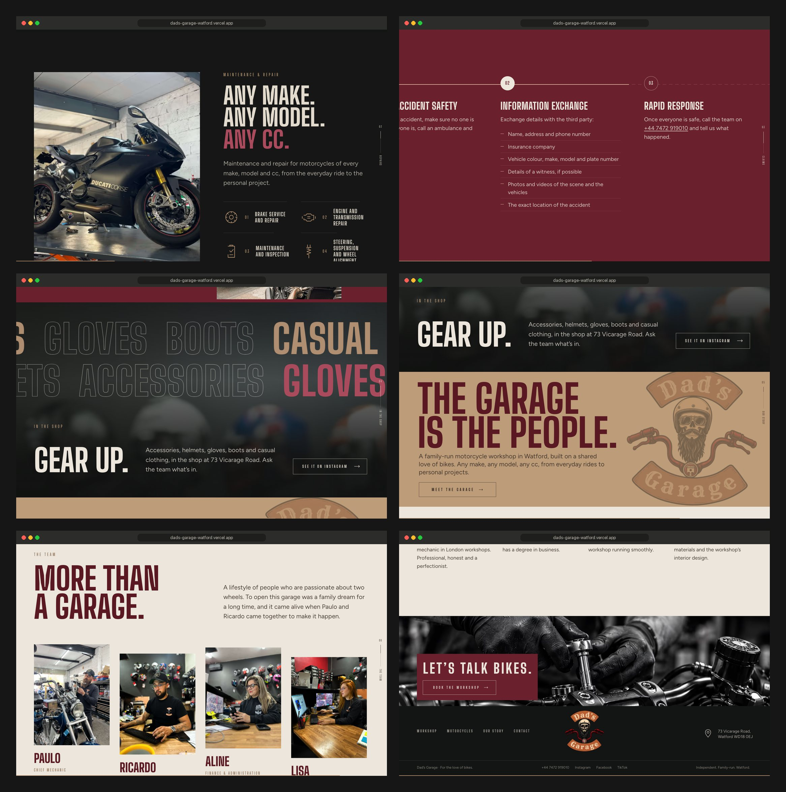
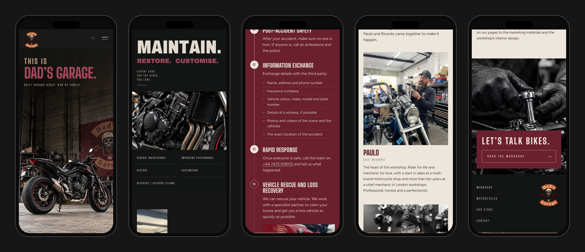
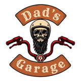

<div align="center">



<h3>A one-page website for a family-run motorcycle workshop in Watford, built around a scroll-driven camera push from the rear wheel to the engine.</h3>

<p>
  <a href="https://dads-garage-watford.vercel.app"><strong>🌐 Live site</strong></a>
  &nbsp;·&nbsp;
  <a href="#hero-animation"><strong>🎬 How the hero works</strong></a>
  &nbsp;·&nbsp;
  <a href="#getting-started"><strong>🛠️ Run it locally</strong></a>
</p>

<p>
  <a href="https://dads-garage-watford.vercel.app"></a>
  
  
  
  
</p>

</div>

<br />

## 🚀 Overview

**Dad’s Garage** is an independent motorcycle workshop at 73 Vicarage Road, Watford, started by Paulo and Ricardo as a family dream. Any make, any model, any cc. The site opens on a black naked bike seen from behind, with the garage’s skull badge painted on the wall. As you scroll, the camera **pushes in towards the engine** and hands over to a full-width close-up of it, and the rest of the page follows the bike’s story: the work, the claims help, the shop, the family behind it, and a phone number.

The look comes from two approved boards: the **hero of revised model 2** and **every section of revised model 3**. The desktop page was rebuilt in the boards’ own pixels and checked against them. The facts that the design kit did not carry (the full repair list, the four-step claims guide, the shop range, the team and the social links) come from the garage’s previous website.

- **Cinematic first impression**: a pinned photographic camera move with real photo plates. No video and no fake 3D orbit
- **One way to get in touch**: every call to action opens the phone, address and directions sheet. Nothing pretends to book or send anything
- **Built for every visitor**: portrait framing on phones, a pause button, reduced-motion and no-JavaScript fallbacks, full keyboard support
- **Light**: about 430 KB transferred on first load at 1440 × 900 and at 390 × 844

<br />

<a name="hero-animation"></a>

## 🎬 The hero animation

<div align="center">
  <a href="https://dads-garage-watford.vercel.app"></a>
  <sub>Scroll-scrubbed on the live site · captured at 1440 × 900</sub>
</div>

<br />

The hero is pinned for 1.6 screen heights (1.27 on phones) and follows the kit’s storyboard:

| Scroll   | What happens                                                                                          |
| :------- | :---------------------------------------------------------------------------------------------------- |
| On load  | The photo settles (1.5 s) and **DAD’S GARAGE.** rises out of its mask; the scroll is never blocked    |
| 0–18%    | The rear three-quarter view, title in place                                                           |
| 18–73%   | The title fades and lifts while the camera pushes towards the engine (scale 1 → 1.38, smoothstep)     |
| 73–100%  | The push completes as the **MAINTAIN.** band rises over the stage, its letters climbing out of a mask |
| After    | The engine close-up keeps the same forward move (scale 1.12 → 1) under **RESTORE. CUSTOMISE.**        |

**Under the hood**

- 📐 **Board units, not guesses.** Every board text box was measured with a pixel scan (`scripts/measure-board.py`). Font size comes from cap height and tracking from ink width (`scripts/fit-type.mjs`), so the CSS is written in board pixels × `frame / 971` (hero) or `frame / 893` (sections).
- 🧭 **A plate that fits every screen.** The kit photo was upscaled (Real-ESRGAN blended with Lanczos to keep the grain) and given 280 px of extra wall above it. A `clamp()` keeps the tyres off the bottom edge and the title clear of the mirror on any aspect. Phones and portrait tablets switch to the portrait plate, so both wheels stay in frame.
- 🔁 **One loop for the whole page.** A single `requestAnimationFrame` engine reads the scroll position, eases it only while it moves and writes transforms. It never captures the wheel or blocks anchors. `?nosmooth` and `?static` exist for captures and tests.
- 🐢 **Graceful by default.** With `prefers-reduced-motion` or the header’s pause button, the runways collapse, nothing is pinned and every section shows its final state.

<br />

## 🖥️ Sections

<div align="center">
  
</div>

<br />

Each section moves in its own way, tied together by a chapter counter on the right edge and a tan progress line along the bottom.

| #   | Section                                   | Anchor      | Motion                                                                                  |
| :-- | :---------------------------------------- | :---------- | :-------------------------------------------------------------------------------------- |
| 00  | **This is Dad’s Garage.** (model 2)       | `#top`      | Pinned camera push towards the engine                                                   |
| 01  | **Maintain. Restore. Customise.** (model 3) | `#workshop` | Letters rise out of a mask, the two actions close in, the engine keeps the push; five service sheets |
| 02  | **Any make. Any model. Any cc.**          | `#repairs`  | The workshop photo wipes open left to right; six line icons draw themselves            |
| 03  | **Make your claim.**                      | `#claims`   | Pinned horizontal road: the four steps ride past, the road draws and each marker lights |
| 04  | **Gear up.**                              | `#shop`     | Two outlined marquee rows run against each other over the shop’s helmet wall            |
| 05  | **The garage is the people.** (model 3)   | `#story`    | Calm: the faint badge turns from +5° to −3°; **Meet the garage** opens the real frontage |
| 06  | **More than a garage.**                   | `#team`     | Columns travel at different speeds; portraits develop from mono to colour at the centre |
| 07  | **Let’s talk bikes.** (model 3)           | `#contact`  | Hands parallax under the burgundy card, which reveals once                              |
| 08  | Footer (model 3)                          | n/a         | Navigation, badge, address, phone and social links                                      |

<br />

## 📱 Mobile first, motion optional

<div align="center">
  
</div>

<br />

- Portrait hero plate: both wheels in frame from 375 px phones up to portrait tablets
- The claims road turns into a vertical timeline that draws as you read
- Full-screen menu with numbered chapters and a call button
- Buttons and navigation links checked at 40 px or more on phones; no horizontal scroll at any of the 8 widths QA tests (375 to 1920 px)
- Nothing depends on hover

<br />

## ✨ Highlights

- **🎞️ Scroll storytelling**: a different technique per section (pin, mask, wipe, path drawing, horizontal track, marquee, parallax depth, colour develop) on one shared engine
- **📞 Honest contact**: the booking buttons open a sheet with the phone number, address, directions and socials. No form that only pretends to send
- **🧾 Content from the garage itself**: repair services, the claims checklist, the shop range and the team come from the garage’s own site; the old site’s heating and air-conditioning line is left out because it doesn’t apply to bikes
- **🧭 Adaptive header**: the board’s tall header over the hero, then a compact bar that hides on the way down and returns on the way up
- **♿ Accessible sheets**: native `<dialog>`, focus moved in and returned, Escape and backdrop close, skip link, one `h1` and no skipped heading levels
- **🖼️ Image pipeline**: `npm run prepare-images` (upscale, headroom, crops) → `npm run images` (AVIF + WebP at several widths, versioned names)
- **✅ Checked in a real browser**: `npm run qa` runs 67 checks (order, copy rules, overflow at 8 widths, hero framing, every dialog clicked, menu, pause, reduced motion, no JavaScript); `npm run compare` diffs the page against the boards

<br />

## 💻 Tech stack

| <br />Vite 6 | <br />JavaScript | <br />HTML5 | <br />CSS3 | <br />Python | <br />Playwright | <br />Vercel |
| :---: | :---: | :---: | :---: | :---: | :---: | :---: |

### Why this stack?

- **Vite + plain JavaScript**: a one-page site for a local business needs no framework runtime. The page is static HTML with three small modules (engine, scenes, UI)
- **Own scroll engine instead of a library**: the motion is a set of measured progress values and transforms, so 12 KB of JavaScript covers the whole page
- **Self-hosted variable fonts**: Big Shoulders Display, Archivo (width axis) and Figtree, with no third-party font requests
- **Python + Playwright for the craft work**: image upscaling, board measurement, captures and browser QA live in `scripts/`
- **Vercel**: every push to `main` deploys automatically

<br />

## 🎨 Design system

| Token              | Value                                                                        | Use                                              |
| :----------------- | :--------------------------------------------------------------------------- | :----------------------------------------------- |
| Charcoal           |  | Page, header, workshop band, footer              |
| Burgundy           |  | Claims section, contact card, primary buttons    |
| Deep burgundy      |  | Titles on tan and bone                           |
| Burgundy on dark   |  | Hero title and RESTORE. CUSTOMISE. (contrast-adjusted) |
| Tan                |  | Brand tan, header button, story section          |
| Bone               |  | Team section, sheets, text on dark               |

- **Type**: Big Shoulders Display 800 for titles, Archivo Black at 71 % width for **MAINTAIN.** and at normal width for **RESTORE. CUSTOMISE.**, Figtree for text; widely tracked Big Shoulders 700 for labels
- **Grid**: desktop sections in board units up to a 1,600 px frame, 43-unit left margin; 20 px gutters on phones
- **Motion**: masks and reveals on `cubic-bezier(.16, 1, .3, 1)`, the camera on smoothstep; no wheels spinning on a parked bike

<br />

<a name="getting-started"></a>

## 🛠️ Getting started

```bash
# Clone the repository
git clone https://github.com/Jeanfr1/dadsgaragewebsite.git
cd dadsgaragewebsite

# Install dependencies (Node 20.10+)
npm install

# Start the dev server  →  http://localhost:5203
npm run dev

# Production build  →  dist/
npm run build

# Preview the production build  →  http://localhost:4203
npm run preview

# Browser QA (67 checks) and the board comparison, against the preview
npm run qa
npm run compare

# Rebuild the images: upscale + crops (Python 3, OpenCV, PyTorch, Real-ESRGAN x4plus weights), then AVIF/WebP
npm run prepare-images
npm run images
```

<br />

## 📁 Project structure

```
dadsgaragewebsite/
├── index.html                  # Every section: hero → workshop → repairs → claims → shop → story → team → contact → footer
├── src/
│   ├── main.js                 # Entry: fonts, styles, modules
│   ├── styles/main.css         # Tokens, board-unit layout, sections, phones, reduced motion
│   └── js/
│       ├── engine.js           # One rAF loop, eased scroll, pause / reduced motion, ?nosmooth & ?static
│       ├── scenes.js           # Per-section choreography, chapter rail, header states
│       └── ui.js               # Sheets (dialogs), services, phone menu, reveals, pause button
├── public/img/                 # AVIF + WebP derivatives (generated, versioned names)
├── scripts/
│   ├── prepare-images.py       # Real-ESRGAN upscale, hero headroom, crops of the garage's photos
│   ├── build-images.mjs        # AVIF / WebP exports, icons, Open Graph image (sharp)
│   ├── measure-board.py        # Pixel-scan of the boards' text boxes
│   ├── fit-type.mjs            # Font size and tracking fitted to those boxes
│   ├── board-compare.mjs       # Page vs boards at 1440 px
│   ├── qa.mjs                  # Browser QA
│   └── shots.mjs · readme-*    # Review captures and README assets
├── references/                 # The approved boards (model 2 hero, model 3 sections)
└── animation/ docs/ images-master/ logo/ site/ tools/ LEIA-ME-KIT.md
                                # The design kit, kept as delivered (excluded from deploys)
```

<br />

## 🚀 Deployment

Hosted on **Vercel** and connected to this repository: every push to `main` ships to production.

**Live site:** [dads-garage-watford.vercel.app](https://dads-garage-watford.vercel.app)

| Setting          | Value           |
| :--------------- | :-------------- |
| Framework        | Vite            |
| Build command    | `npm run build` |
| Output directory | `dist`          |

The preview is not indexed (`noindex` in the page, an `X-Robots-Tag` header and `robots.txt`) until the garage moves its domain.

<br />

## 📌 Content checklist

Items waiting on the garage. Each one is marked `TODO(dads)` in `index.html`.

- [ ] Permission to use the workshop, van and team photos taken from the garage’s website
- [ ] Confirm the team and roles are current (bios are condensed from the old site)
- [ ] Confirm the wording of claims step 03, **Rapid response** (the old site repeats step 01 there)
- [ ] The garage’s own Google place link (directions currently search by name and address)
- [ ] Opening hours and the landline on the shop sign (01923 222455), which are not shown until confirmed
- [ ] The owner’s master logo file (the badge is a clean reconstruction from the avatar)
- [ ] Sign-off on the hero, engine and hands images from the design kit
- [ ] Custom domain (then add `canonical` and `og:url` and drop `noindex`)

Brief choices made along the way:

- **Burgundy on dark**: the board’s title red (#7E2E37) is too dark on the charcoal wall, so the kit’s contrast-adjusted #A4495B is used, as the kit specifies
- **Type**: the kit’s demo used Nimbus Sans Narrow; the boards were matched instead (Big Shoulders Display, Archivo)
- **Board sections stay exact**: the kit demo’s numbered kickers and hero footer are not on the boards, so they are left out of those sections; new sections carry their own labels
- **The old site only supplied facts**: no layout, colours or motion came from it, and its heating/AC line, 24/7 promise, hours and prices were not carried over

<br />

## 🙏 Acknowledgments

- **Dad’s Garage**: Paulo, Ricardo, Aline and Lisa, for the story, the services and the photos
- **[Big Shoulders Display](https://fonts.google.com/specimen/Big+Shoulders)** by Patric King, **[Archivo](https://fonts.google.com/specimen/Archivo)** by Omnibus-Type and **[Figtree](https://fonts.google.com/specimen/Figtree)** by Erik Kennedy (all OFL)
- **[Real-ESRGAN](https://github.com/xinntao/Real-ESRGAN)** for the upscaling model (BSD-3-Clause)
- **[Vite](https://vite.dev)**, **[Playwright](https://playwright.dev)** and **[Vercel](https://vercel.com)**

<br />

---

<div align="center">
  
  <p><strong>For the love of bikes.</strong></p>
  <p>Built with ❤️ by <a href="https://github.com/Jeanfr1">Jean</a> for Dad’s Garage</p>
  <sub>© 2026 Dad’s Garage. All rights reserved.</sub>
</div>
